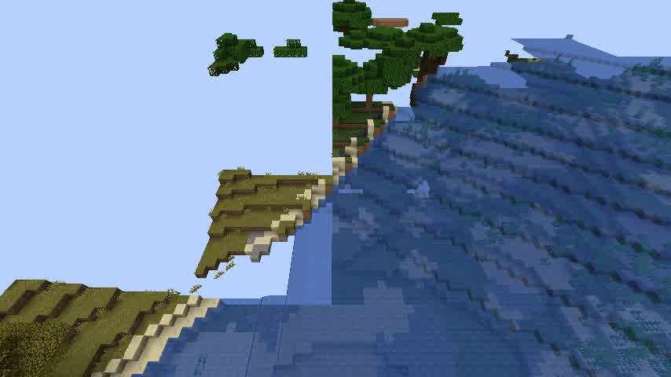
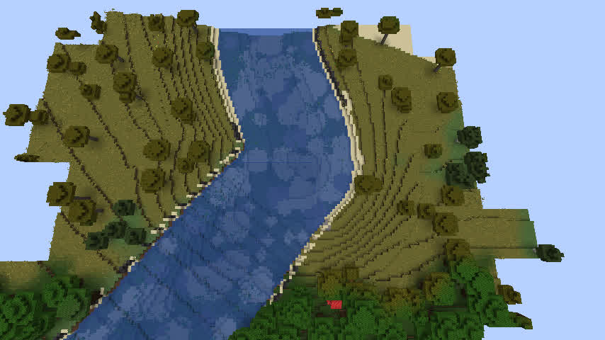
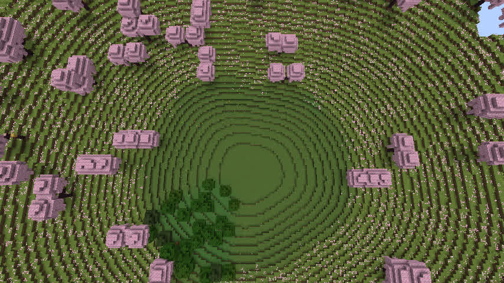
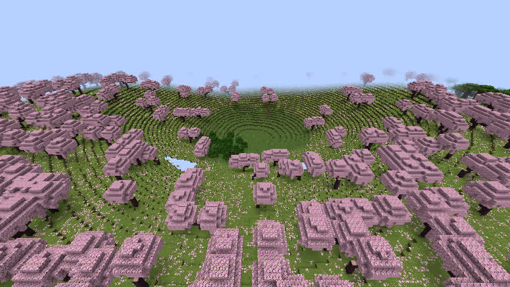

# GeoWorld R8.1m — v1.1.26 实际 Minecraft 客户端视觉复验

日期：2026-11-12（dadm，独立 Xvfb :99）。  
测试构建：Minecraft **1.21.1** + NeoForge **21.1.211** + 当前源码规则 **geoworld-rules-v1.1.26**。  
**注意**：开发版模组 UI 的 `GeoWorld 0.1.4` 是 Gradle 测试元数据，并非历史公开 0.1.4；不可把截图误认作旧版本。

## 结论

**Windows CI 9/9 PASS，真实游戏客户端已成功加载，但地貌视觉验收 FAIL：天坑 #9 仍明显不自然。v0.1.5 RC 不允许合并、打标签或发布。**

本轮没有改变地貌、模型、世界绑定、现有历史存档算法。仅从已经验证、正常保存的 R8.1g 独立测试世界复制一个**隔离副本**进入 NeoForge 开发客户端；未修改源世界。使用原生游戏摄像机实际进入世界、旁观模式设置视角、采集画面；截图只裁掉了虚拟 X 显示器的黑色边框。测试结束已由集成服务端正常保存全部维度和退出，随后关闭开发客户端和 Xvfb，不残留测试进程。

### 真实世界身份验证

对客户端副本运行 `scripts/verify_geoworld_voxel_world.py`，要求精确 `--expect-rules geoworld-rules-v1.1.26 --expect-seed 123456`：

- Minecraft 生成器 `geoworld:geoworld`；
- `level.dat` seed=123456；
- 持久化 `data/geoworld/geoworld.properties` binding seed=123456，规则版本 v1.1.26；
- 原始保存区域存在 **12 个** region 文件，全部前置校验 PASS。

游戏内日志确认真实传送、游戏模式和昼夜设置。客户端运行在 Mesa llvmpipe 软件 OpenGL 4.5 下，帧率曾约 4 FPS，因此**初始画面上会出现异步尚未绘制的区块空白**；后续补齐的画面确认不能把此类短暂空白当成地形缺失。

## 1. 河口 — 局部视觉观察

- Seed=123456；坐标邻近先前的水面缺陷位置 `(10814,2467)`；
- 客户端旁观模式从 `(10816,90,2490)` 斜视河岸，并在 `(10815,145,2480)` 俯视；
- 已呈现两岸连续的河道与水面，在截取的局部画面未见原先突然高出多格的隔断。
- **结论：仅局部初步视觉 PASS，不等于整条主河、河口出海或所有地理环境通过。** R8.1g 实际 Anvil 保存方块曾对指定矩形 1517/1517 列、2762 个相邻水面、0 超限落差做过独立专项验收。

## 2. 天坑 #9 — 视觉 FAIL

- Seed=123456；天坑中心 `(6080,7744)`，R8.1e 数值模型检查过该坑；
- 实际客户端俯视视角 `(6080,160,7744)`、pitch 80；斜视 `(6080,155,7620)`、pitch 35；
- **清晰的近乎正圆坑体；大量等距同心环状地形阶梯；缺少自然侵蚀形成的非对称坡谷、局部滑塌与堆积**。从俯视和白天斜视角度均可稳定复现，并非加载中缺少区块造成；
- 旧的 v1.1.25 数值专项验证“最大采样坡率 0.5”和减少坑底平板只证明局部坡率改善，**不保证外观真实**。

## 3. 原因已缩小到公式，不应盲修

Go `internal/specialfeatures/model.go`：v1.1.25 / v1.1.26 的圆坑高度仍主要使用 `smoothstepRange(0.035, 0.98, radial)` 的单一径向混合，`sinkholeTalusVariation` 的低幅值不能改变高度等值线的主导环状性质。Java `java/runtime-reader/.../GeoWorldV1.java` 使用同构算法，所以这是**模型规则层面的系统性外形问题**，不只是客户端着色或树木纹理问题。

### 下一阶段限定目标（不在本证据提交中盲目修改）

- 新规则须使用独立生成版本（候选 v1.1.27），**不能覆盖已持久化 v1.1.26 和更早规则**。
- 天坑 rim 保持规划位置与尺度，但径向外形须加入受控的非对称长波变化、坡谷和局部堆积；仍不允许抬高未改变的天然地表、不穿越原有正式河网或现有水域、不得重新规划其他结构。
- Go/Java 同构及旧模型回归，至少 `123456`、`20261112`、`-90210` 多种子真实方块坡面与实际客户端相机共同验收；不能以俯视投影代替游戏内画面。
- 保留 R8.1g 入海口零超限自由落差契约，不能为了天坑而破坏水文。
- 正式 RC 继续 HOLD；PR #2 保持 Draft，CI 9/9 PASS 不能越过视觉 FAIL。

## GitHub CI 参考

- 已成功完成的 Windows 九目标工作流：<https://github.com/wanstu/minecraft-geo-world/actions/runs/43221769793>（47 / SUCCESS）。
- 受保护的候选 PR：<https://github.com/wanstu/minecraft-geo-world/pull/2>（Draft；尚未合并、未发布）。
