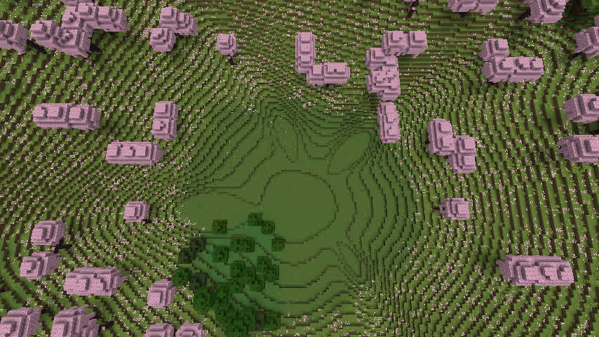
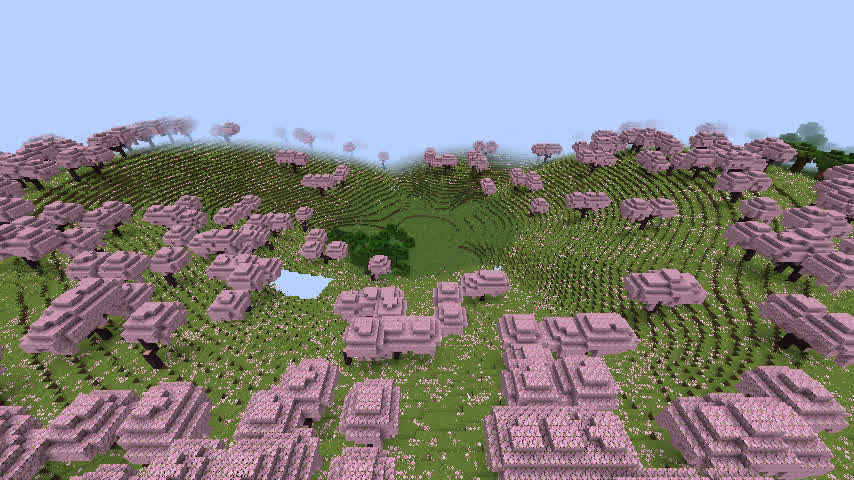

# GeoWorld R8.1n — 天坑 v1.1.27 定向侵蚀候选与真实客户端验收

日期：2026-11-12（dadm）；候选分支：`adm/geoworld-r81n-natural-sinkhole-20261112`。  
上一已验证基线：`f5d4491`，对应 v1.1.26，R8.1m 真实客户端天坑 #9 同心环视觉失败。  
**最终结论：候选 v1.1.27 的模型、跨语言、1.21.1 NeoForge 构建和真实方块专项通过；实际 Minecraft 天坑视觉「有改善，但仍 FAIL」。v0.1.5 RC = HOLD。**

## 目标与实际代码

### 天坑坡面，仅新规则

Go：`internal/specialfeatures/model.go` 的 `usesDirectionalSinkholeErosion` / `sinkholeDirectionalRelief`。  
Java：`java/runtime-reader/src/main/java/geoworld/runtime/GeoWorldV1.java` 中对应公式。

- 保持 v1.1.26 及更早所有已保存模型的径向高度解释，只有 **v1.1.27** 进入新算法。
- 加入受边界衰减约束的长波非对称地形扰动，以及四条具有不同宽度、强度和弯曲轴线的定向侵蚀沟谷。
- 坑中心的规划最低高程不变，外圈与自然地面连续衔接；不抬高既有天然地表，不切入已有河湖，不改变 GeoWorld 规划器的天坑中心、河段或海洋边界。
- 新规则只在该独立开发分支成为当前生成默认。旧正式 JAR 和旧世界不升级、不迁移。不要用开发 JAR 的 `0.1.4` 元数据推断公开模组版本。

### 版本与客户端构建

同步扩展 Go 世界模型、保存/加载判断和 Java 核验的版本保护逻辑，桥接层的缓存标识改为 `v27` 防止缓存跨规则误用。Go 旧版本测试仍显式锁在 v1.1.26。

NeoForge 1.21.1 完整 Gradle `check build` 成功：**44 项任务，0 失败**。第一次完整构建唯一失败为原有 WebUI 崩溃恢复端口检查仍要求使用旧端口；操作系统可因 TCP TIME_WAIT 临时占用此端口。参照 26.3 NeoForge 已通过的实现，将 1.21.1 这项**测试逻辑**改为验证新进程、新 URI 对应端口及 `/api/status` 实际返回 HTTP 200。重新执行构建后全部通过；没有调整 WebUI 生产代码或地貌算法来掩盖错误。

## 模型验收

参考已经由 Minecraft 1.21.1 NeoForge 正常保存的真实 v1.1.26 世界配置，独立重新生成 v1.1.26 与 v1.1.27 两份模型。

**种子 123456** 的结果：

| 指标 | 结果 |
|---|---:|
| 正式河网结构 | 完全相同 |
| 所有特殊地貌规划对象 / 位置 | 完全相同 |
| 底层宏观 `Surface` | 完全相同 |
| 海岸退水规则版本 | 均为 2 |
| 被抽样的天坑 | 4 |
| 老/新高度对照样点 | 1536 |
| 与旧版相比高度显著变化的样点 | 661 |
| Go/Java v126+v127 采样最大归一化差值 | 1.11022302463e-16 |
| 四个天坑采样最大坡率 | 0.677 Y/格 |
| 基础陆地意外抬高、原有水域变化 | 0（受检样点） |

上述为模型采样和代码兼容检查，不是实际方块结果。可重复脚本：`cmd/geoworld-r81n-audit/main.go`，其 JSON 结果 `docs/acceptance/r81n_seed123456_candidate.json`。Java 配对校验：`java/runtime-reader/src/main/java/geoworld/runtime/GeoWorldR81nPairedSamplerVerifier.java`。已新增 Go 回归：`internal/specialfeatures/r81n_sinkhole_visual_test.go`，涵盖新旧规则隔离、正式河水不受影响、其他特殊地貌不变、最大局部坡率。

### 追加两个种子：模型级回归，不是实际 Minecraft 世界

在同一真实 GeoWorld 世界几何参数下，额外检查 `20261112` 和 `-90210` 两个种子的旧新完整模型：均为各 4 个天坑，河网、特殊地貌规划、基础 Surface 深比较全部相同，海岸水文规则均保持 2。

| 种子 | 天坑数 | Go/Java 配对点 | 高度显著变化点 | 最大归一化地面坡率 |
|---|---:|---:|---:|---:|
| 123456 | 4 | 1536 | 661 | 0.677 |
| 20261112 | 4 | 1536 | 667 | 0.661 |
| -90210 | 4 | 1536 | 679 | 0.658 |
| **合计** | **12** | **4608** | **2007** | **不超过 0.677** |

所有三个种子 v1.1.26 / v1.1.27 的 Java/Go 配对校验均 PASS，最大归一化误差仍为约 `1.11e-16`。完整证据：
`docs/acceptance/r81n_seed123456_candidate.json`、
`docs/acceptance/r81n_seed20261112_candidate.json`、
`docs/acceptance/r81n_seedNeg90210_candidate.json`。

**限制：后两个种子仅模型级检验，不属于真实 Minecraft 已保存方块或客户端视觉检查。**

## 从空目录创建的真实 Minecraft 世界

`java/adapters/1.21.1-neoforge/run/R81nFreshSeed123456` 在启动前不存在。由真实 **Minecraft 1.21.1 + NeoForge 21.1.211** 服务端加载当前 v1.1.27 源代码创建，配置只绑定本机 127.0.0.1 的测试端口，RCON 密钥只在忽略的本地配置内。

- 创建日志：`Done (29.349s)`，之后成功保存绑定 `geoworld-rules-v1.1.27`。
- 强制生成并保存中心 `(6080,7744)` 周围 **225 个区块**，之后撤销强制加载，再次 `save-all flush` 并正常 `stop`；所有维度保存完成。
- 实际 `level.dat` / GeoWorld 绑定验证：生成器 `geoworld:geoworld`，种子 123456，保存模型规则 v1.1.27，区域文件存在。
- 只读解析真正的 Minecraft Anvil 方块状态：天坑 #9 东西 **27/27**、南北 **27/27** `minecraft:full` 列，中心天然基底 Y74，未检出中心积水；两条剖面的 8 格间隔最大高度变化均约 **0.625 Y/格**。
- 原服务端存档只复制到客户端隔离 `saves`，原世界与历史 v1.1.26 世界均不覆盖。
- 原生方块原始数据：`docs/acceptance/r81n_seed123456_actual_voxels.json`。 **54 列专项通过，不能推论所有天坑全部区块通过。**

## 实际 Minecraft 客户端相机：仅部分改善，FAIL

在隔离 Xvfb :100、Mesa llvmpipe 软件 OpenGL 的 **真实 NeoForge 开发客户端**（不是 Anvil 高度投影、不是图像生成）进入实际保存的 v1.1.27 世界。开启测试指令，仅在存档副本中旁观查看。白天、隐藏 HUD，两张截图经裁掉虚拟桌面黑边后直接保存，无风格处理。

- 俯视 `(6080,160,7744)`，yaw=0，pitch=80。
- 斜视 `(6080,155,7620)`，yaw=0，pitch=35。
- 与相同地点 R8.1m v1.1.26 游戏截图相比，一些整齐同心环已被弯曲的坡谷切断，局部地形高度确实变化；但整个坑体仍太近似圆形，中心宽阔平坦，外坡仍有大量清晰环形台阶。
- 软件渲染下远景个别未完成的区块会暂时显示天空；不能将它当成地形崩坏，也不能对未加载区块宣称视觉验收。最终保留的是主要坑壁可见的较完整画面。
- **视觉 verdict：IMPROVED_BUT_FAIL**。上面所有定量测试通过都**不**改变该结论。后续应重点优化中心平底过渡、非对称滑塌/堆积地貌与环状高度量化视觉，而不是继续追求更低的数值坡率。更改须有新版本隔离，不允许直接悄悄改已经保存的旧世界。

**真实游戏截图：**

旧规则同坐标对照截图位于 R8.1m：
`docs/acceptance/r81m_v126_client_sinkhole_seed123456_topdown.jpg` 和 `r81m_v126_client_sinkhole_seed123456_oblique.jpg`。

## 不可冒进的发布边界

- v1.1.27 尚未运行 GitHub 官方 Windows 九目标 CI。上一轮 v1.1.26 的 9/9 CI 成绩**不可算到 v1.1.27 上**。
- 当前仅一个种子的实际 Minecraft 区块与相机；其他生态区和天坑未完成客户端验收。
- 单机测试是 llvmpipe 软件渲染，后续有条件可用 eadm GPU 重验画面，但该限制不影响本轮发现的明显同心圆外形问题。
- 不合并到 `master`、不创建发布标签、不发布 JAR，也不执行任何旧世界迁移。
