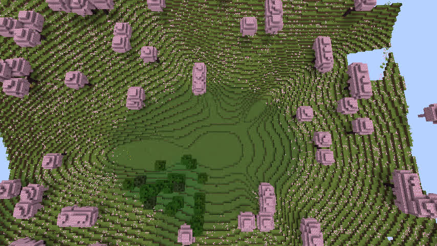
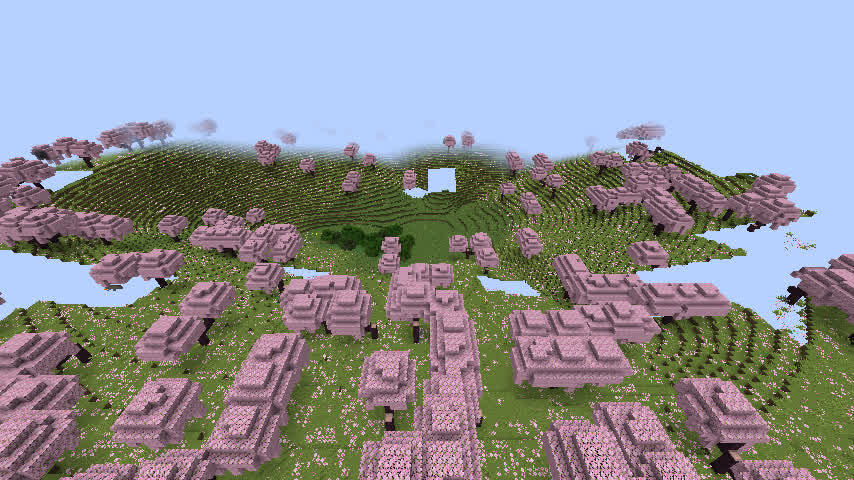

# GeoWorld R8.1o — 坑底非对称化候选 v1.1.28

日期：2026-11-12；开发机器：dadm；起点提交：`e0c5abc`（R8.1n / v1.1.27）。  
**最终验收：模型一致性 PASS、Go/Java 配对 PASS、NeoForge 1.21.1 完整构建 PASS、原生 Minecraft 方块专项 PASS；真实客户端地貌视觉 FAIL。v0.1.5 RC 继续 HOLD。**

## 本轮只解决一个问题

上一轮真实游戏俯视显示，天坑 #9（种子 123456，中心 X=6080，Z=7744）中心是一个相当规则的圆形平底；草地核心判定固定径向 `0.34`，外围依旧有一圈圈同心坡线。本次没有改河网、海口、湖泊、矿区、其他特殊地貌的规划，也没有把前面通过的东西重新设计一遍。

新增候选规则 `geoworld-rules-v1.1.28`，只在新版本引入：

1. 坑底和下坡肩使用有方向的大尺度波瓣扰动，而不是相同圆周每个方向同一 Y。
2. 核心地形高度使用小幅线性/平滑混合，试图减小被 Minecraft 整数 Y 量化后的平底宽度。
3. 可居住的 `Plain` / `Canyon` 核心过渡改由同一非对称坡面半径控制，并把基准范围从 `0.34` 缩小到 `0.28`。
4. 坑底中心规划高程及已验证的外围足迹不动，版本隔离保持 **v1.1.27 及更旧存档计算结果不变**。

Go 实现：`internal/specialfeatures/model.go`；Java 对等实现：`java/runtime-reader/src/main/java/geoworld/runtime/GeoWorldV1.java`。候选默认规则只存在本隔离工作树；本次未发布 JAR 或迁移旧世界。

## 程序级 / 模型级对照

参考真正由 Minecraft 保存的 v1.1.27 世界模型，独立生成 v1.1.27 与 v1.1.28 对照模型：

| 种子 | 天坑数 | Go/Java 配对点 | 地面高度变化大于 0.002 的点 | 最大模型坡率（Y/格） |
|---|---:|---:|---:|---:|
| 123456 | 4 | 1536 | 507 | 0.886 |
| 20261112 | 4 | 1536 | 512 | 0.797 |
| **合计** | **8** | **3072** | **1019** | **不超过 0.886** |

所有配对对照除 `groundHeight` 和 `waterKind` 外，还逐点检查了 `terrainVariant`，以免仅高度匹配、核心地貌类别却不同。最大 Go/Java 归一化高度差约 `1.11e-16`。两种子的河网、特殊地貌规划及宏观 Surface 全部保持不变；海岸回水版本依然为 2。模型样点没有发现变更原有水域或抬高天然地表的情况。

证据：`docs/acceptance/r81o_seed123456_candidate.json`、`docs/acceptance/r81o_seed20261112_candidate.json`。可重复脚本：`cmd/geoworld-r81o-audit/main.go`；Java 跨语言核验器 `GeoWorldR81oPairedSamplerVerifier`；定点 Go 测试 `internal/specialfeatures/r81o_sinkhole_floor_test.go`。

NeoForge 1.21.1 完整 Gradle `check build`：**44 tasks，BUILD SUCCESSFUL in 6m16s**。具体 1.21.1 客户端和服务端均由此版本源码实际启动，并非仅凭编译推测方块效果。

## 真正 Minecraft 世界及 Anvil 方块

新世界 `R81oFreshSeed123456` 在服务端首次启动前不存在，由 NeoForge 1.21.1 服务端自动创建，绑定 `geoworld-rules-v1.1.28`。日志 `Done (27.752s)`；通过 localhost 测试 RCON 在天坑 #9 周围真实生成 **225 个区块**，保存后撤销强制加载，再次 `save-all flush` 并正常停服。完整存档只复制给本地测试客户端；**没有覆盖此前任何验收世界**。

只读解码实际 Minecraft Anvil 方块 `minecraft:full`：

| 指标 | 上轮 v1.1.27 | 本轮 v1.1.28 |
|---|---:|---:|
| 天坑中心地面 Y | 74 | 74 |
| 东西剖面完整列 | 27 / 27 | 27 / 27 |
| 南北剖面完整列 | 27 / 27 | 27 / 27 |
| 东西最大坡率 Y/格（8 格间隔） | 0.625 | **0.875** |
| 南北最大坡率 Y/格（8 格间隔） | 0.625 | 0.625 |
| 与中心同高的采样点（东西） | 8 | **9** |
| 与中心同高的采样点（南北） | 3 | 3 |
| 中心积水 | 无 | 无 |

数据：`docs/acceptance/r81o_seed123456_actual_voxels.json`。上轮数值来自 R8.1n 已保存的真实世界 Anvil 证据。它说明**非对称变化确实生效，但并未缩小所有方向的平坦地面，且某一方向坡率反而增加**。

## 真实游戏相机对照：视觉 FAIL

在 Xvfb :101 + Mesa llvmpipe 软件 OpenGL 上运行**真正 Minecraft 1.21.1 NeoForge 客户端**，读取上述服务端保存的原生世界副本。玩家使用测试命令切至观察模式，时间固定正午，隐藏 HUD。与 v1.1.27 实机验收相同机位：

- 俯视：`/tp @s 6080 160 7744 0 80`
- 斜视：`/tp @s 6080 155 7620 0 35`

观察结果：坑底的部分等高线形状已经改变，但中央仍可见宽阔、较平的深绿色核心，外围依旧出现规则环状的台阶线。斜视更容易看到坡面整体仍像规则函数形成的碗状体。软件渲染的远处不完整区块出现天空空洞，只能视为渲染/区块尚未完整显示，不得擅自归结为地图地形崩坏；独立验证的 54 列实际 Anvil 数据均为完整区块。

**R8.1o 结论：实现正确性 PASS，地貌目标 FAIL，不进入发布。**

## 下一轮改造的工程建议（本轮不扩大范围）

不要继续盲目增加圆周角向波动；它把某些方向坡面变陡，却没有从根本上消除平底。建议先在同一位置做“真实侵蚀 + 坡积扇”的单项对照：把一侧坡面的侵蚀物质在下坡与坑底边缘分布成连续的坡积扇，而不是直接叠加随机纹理或新的同心函数。剖面验收以 **减少同高平底采样、控制连续坡率不高于当前旧版本并避免新陡崖** 为门槛；再使用实际 Minecraft 相同相机和视觉验收，失败则继续 HOLD。

**边界：v1.1.28 还未执行 Windows 9 目标官方 CI；不合并、不发布、不替换 v0.1.4 或已保存世界，也不声称视觉验收通过。**

机器可核验摘要：`docs/acceptance/r81o_real_client_visual_evidence.json`。
