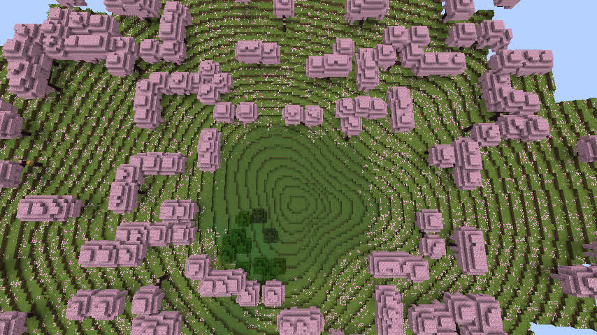
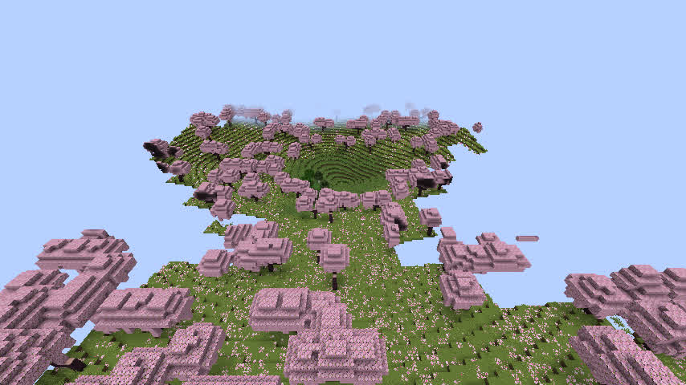
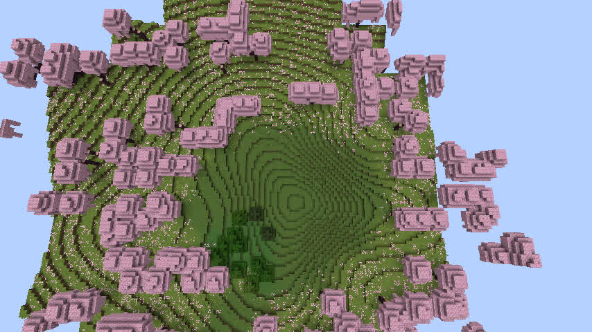
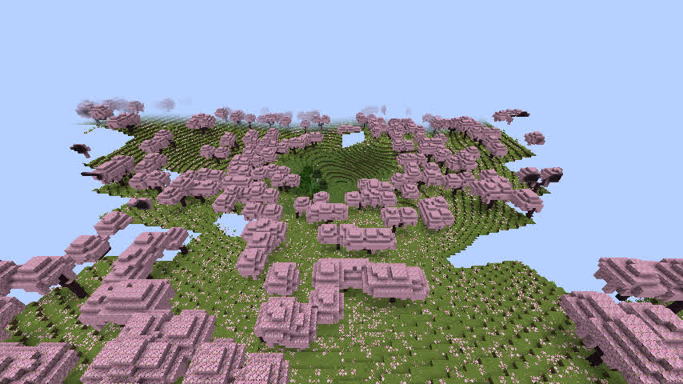

# GeoWorld R8.1p — 天坑坡面侵蚀 / 坡积扇候选 v1.1.29

**日期：2026-11-13** · 机器：dadm · 源基线：`eb78012`（v1.1.28）· 隔离开发分支：`adm/geoworld-r81p-sediment-fans-20261113`

**最终结论：代码与双语采样通过，原生 Minecraft 方块指标改善；但两轮真实游戏视觉仍不能验收，v0.1.5 RC 继续 HOLD。** 没有合并到 master、没有发布 JAR、没有迁移旧世界。

## 1. 本轮要修复的缺陷

v1.1.28 虽然打破了一部分圆形平底，但截图里仍出现大范围近似圆形的阶梯坡。原高度函数对中心径向距离过于敏感，几乎任何方向都在同一半径形成等高线。单纯增加角向扰动还可能抬高局部坡率。

R8.1p 尝试把侵蚀与沉积组织成同一组连续的方向性过程，而不是再叠加独立的随机噪声：

- 三条不等权、轻微弯曲的上坡冲沟在半径约 0.4–0.8 的坡面取走局部地形高度。
- 对应方向下坡形成逐渐展开的扇状沉积，靠近坑底的半径约 0.08–0.5，扇形宽度往里增大。
- 用更稳定的中心非零坡度代替低半径的纯 smoothstep，以减少整数方块 Y 形成的平坦圆盘。
- 侵蚀源与沉积量按归一化平面面积做近似配比，**这是简化的地貌启发式模型，不是连续流体/沉积物守恒模拟**。
- 已有河流、水体、原始天坑规划位置、底层宏观地形与旧版本存档计算保护保持不变。仅新 v1.1.29 用本轮算法。

Go：`internal/specialfeatures/model.go`，包括 `usesSedimentFanSinkhole`、`sinkholeSedimentTransfer`。  
Java：`java/runtime-reader/src/main/java/geoworld/runtime/GeoWorldV1.java` 对等计算；Java 桥接的缓存标识隔离到 `v29`。

## 2. 两次候选调整与结果

### A：第一版（已判 FAIL）

使用较窄的冲沟和较小沉积量；原先 v1.1.28 的径向扭曲缩小至 45%，基础坡度按 65% 线性半径 + 35% 平滑半径计算。

- Go v1.1.29 专项测试：通过，包括旧版本隔离、已有河流保护、其他特殊地貌不变、源/扇同时存在、源/扇近似体积比例、合成局部坡率和同高平底减小。
- 真实 Minecraft 1.21.1 NeoForge 新世界 `R81pFreshSeed123456`，种子 `123456`，天坑 #9 中心 `(6080,7744)`。
- 保存 225 个真实生成区块；Anvil 样本 54/54 完整，中心 Y=74，无积水；东西与南北最大 8 格尺度坡率均为 0.375，中心同高采样点均为 1。
- **俯视实际画面呈现几乎教科书式的规则同心圆漏斗。失败。** 数值上的“平底消失”没有换来视觉自然化。

保留证据：`docs/acceptance/r81p_seed123456_candidate_a.json`、`r81p_seed20261112_candidate_a.json`、`r81p_seed123456_actual_voxels_a.json`。A 是同一未发布候选内的一次参数诊断，不代表一个正式版本。A 运行时文件和旧真实世界留在隔离工作树中，未覆盖已有其他版本。

### B：定向增强后再次验收（当前代码，仍 FAIL）

针对 A 的根因调节：不等权冲沟提高强度但扩宽横截面，坡积扇增强并扩大覆盖，靠近中心的沉积由短促上升改为更长的平滑起坡，恢复约 75% 的原空间扭曲。A 中最初直接增强系数会在 12 格附近产生合成坡率 0.866，被专项阈值拦下；延长沉积过渡后专项测试重新通过。

**两个种子完整配对模型**（v1.1.28 与 B）：

| 项目 | 结果 |
|---|---|
| 种子 | 123456、20261112 |
| 规划天坑 | 8 |
| Go/Java 高度、水域、地形类别配对 | 3,072/3,072 PASS |
| 高度显著变化点 | 1,433 |
| Go/Java 最大归一化高度误差 | 1.11×10⁻¹⁶ |
| 河网、特殊地貌规划位置、宏观地形 | 完全一致 |
| 海岸回水版本 | 均为 2 |
| 模型样点的原有水域变化、抬高天然地表 | 0 |

其中天坑 #9 同一归一化半径、48 个角向采样的高度跨度（方块近似量化）：半径 0.23 从 A 的 4 格扩展到 B 的 10 格；0.43 从 3 到 6 格；0.58 从 5 到 8 格。但**角向高度跨度变大不能替代真实游戏验收**。

**Minecraft 实际方块**：

| 指标 | v1.1.28 基线 | R8.1p A | R8.1p B |
|---|---:|---:|---:|
| 东西完整列 | 27/27 | 27/27 | 27/27 |
| 南北完整列 | 27/27 | 27/27 | 27/27 |
| 中心天然地面 Y | 74 | 74 | 74 |
| 中心积水 | 无 | 无 | 无 |
| 东西最大自然坡率（每 8 格） | 0.875 | 0.375 | **0.500** |
| 南北最大自然坡率（每 8 格） | 0.625 | 0.375 | **0.500** |
| 东西中心同高样点 | 9 | 1 | **1** |
| 南北中心同高样点 | 3 | 1 | **1** |

B 的新世界名称：`R81pBFreshSeed123456`，实际创建、保存、停服和客户端副本均通过。不是修改 A 或已发布存档。检查工具：`scripts/r81p_actual_sinkhole_voxel_audit.py`；JSON：`docs/acceptance/r81p_seed123456_actual_voxels_b.json`。

**视觉判断：** B 的左右坡体不再完全对称，沟谷/坡积影响局部等高线；但核心区域还是单一低点为圆心的一圈圈嵌套高度环，地貌整体仍像程序控制的圆形漏斗。单凭坡率和平底样本通过不能宣布目标达成。

截图来自真实 Minecraft 1.21.1 NeoForge 客户端，Xvfb :102、Mesa llvmpipe 软件渲染，时间为正午、HUD 隐藏。相机：

- 俯视：`/tp @s 6080 160 7744 0 80`
- 斜视：`/tp @s 6080 155 7620 0 35`

软件渲染下远处区块可能尚未完成网格加载，出现天空缺口；不能把缺口断言为真实地形孔洞，真正保存的 54 列方块检查全为完整。

## 3. 构建、测试及发布门禁

- A：Go 完整相关模块测试通过；NeoForge 1.21.1 `gradlew check build` **44 tasks / BUILD SUCCESSFUL**；Go/Java 数值一致，真实 Minecraft 新建世界/方块/客户端已验证。
- B（当前提交候选）：针对性 Go 测试通过；Go/Java 3,072 点一致；NeoForge `runServer` / `runClient` 都从当前源编译并实际启动，但 **B 未再次执行完整 `check build`**。不要把 A 的 44/44 成绩冒充 B 的完整构建结果。
- B 的 Windows 9 个 CI 目标未执行；视觉 FAIL，**不申请发布、不合并 master、不发布 JAR、不迁移旧世界**。
- 证据文件中已明确 `visualPass=false`、`releaseEligible=false`，拒绝单纯以数值指标越过发布门槛。

## 4. 下一阶段的明确设计方向

**不要再继续无限提高角向波动系数。** 这两轮确定了“原始高度场主要由单个中心点的半径决定”才是环状漏斗的根因。

下一阶段需要先在文档/小范围模型中设计一个**偏心、分区、流向主导的侵蚀—坡积地貌**，用坡向、集水汇流和下坡堆积的空间位置决定局部形状，而不是在整张圆形碗上叠加三条曲线。可以尝试：

1. 非同心的多处崩塌源头与下坡扇体，其中心、影响区由地形坡向和流路相互制约，不再共享一个严格圆心；
2. 一段非对称的狭长槽谷与坡积扇填充局部洼地，让最低地形带形成面状或短线状，而不是同一个数学点；
3. 继续用真实方块相机图+完整剖面联合拒绝明显的环纹、破碎断崖和异常河流。

**停在阶段验收，不把该候选延伸为正式 RC。** 本轮所有保留证据：`docs/acceptance/r81p_real_client_visual_evidence.json`。
