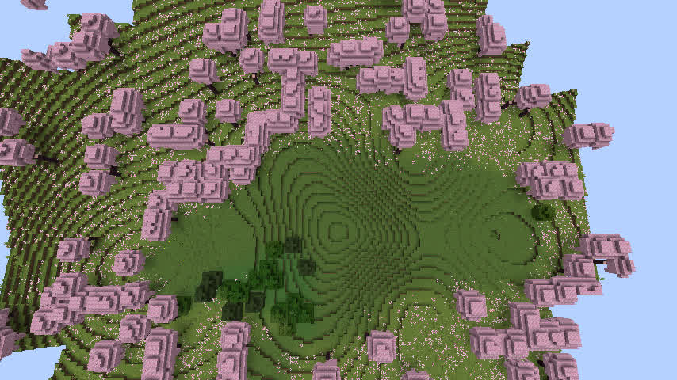
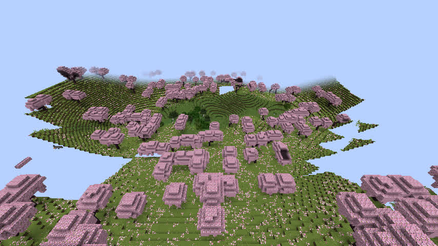

# GeoWorld R8.1q — 偏心多洼地天坑候选与真实游戏验收

日期：2026-11-13 · dadm · 基线：`51d20ac`（R8.1p，规则 v1.1.29）  
候选：`geoworld-rules-v1.1.30` · 分支：`adm/geoworld-r81q-nonconcentric-sinkhole-20261113`

**最终阶段结果：Go/Java 一致 PASS，NeoForge 1.21.1 完整构建 PASS，真实 Minecraft 世界与 Anvil 方块检查 PASS，但局部坡度退步、真实客户端视觉 FAIL。继续 HOLD，禁止合并和发布。**

## 一、目的与改造边界

R8.1p 的两轮真实游戏截图都显示天坑中心有一圈圈规则等高线。即使附加侵蚀沟和坡积扇，整体高度仍主要取决于距离单一中心点的半径。

本轮限定在天坑几何，保留上版已经通过的河网、特殊地貌规划、宏观地表、矿区及海岸处理。选用两个由 Feature ID 决定旋转方向的偏心、不同扁率、不同深度的次级洼地，和中央原始洼地通过光滑最小值组合，尝试直接改变等高线的组织方式，而非继续增大随机扰动。候选只绑定规则 `v1.1.30`，旧 v1.1.29 及更早版本保持各自计算逻辑；不迁移旧存档、不改模型格式。

Go：`internal/specialfeatures/model.go` 的 `usesNonConcentricSinkhole`、`sinkholeCompoundReliefRadius`。  
Java：`java/runtime-reader/src/main/java/geoworld/runtime/GeoWorldV1.java` 的对等浮点计算。新建世界的 profile 和引擎缓存版本分别切到 v1.1.30 / v30。

**注意：算法是多个距离场的几何合成，不是真实的集水汇流或物质守恒模拟。** 本轮最终证据证明光滑合成几个圆形/椭圆形洼地仍不能得到可信的自然天坑。

## 二、模型与跨语言检查

| 项目 | R8.1q |
|---|---:|
| 种子 | 123456、20261112 |
| 天坑 | 8 |
| Go/Java 配对点 | **3,072 / 3,072 PASS** |
| 高度变更采样点 | 1,036 |
| 最大跨语言归一化高度差 | 1.11×10⁻¹⁶ |
| 河网、特殊地貌位置、宏观 Surface | 全保持不变 |
| 水体受影响点、天然地面被抬高点 | 0 |
| 海岸回水版本 | 2 / 2 |
| 候选模型中单点最大采样坡率 | 约 0.937 |

专项 Go 验证包括新规则隔离、旧规则不变、精确中心、外围原有足迹、已有河流及其他特殊地貌保护，以及测试两处典型天坑的偏心轮廓。四个相关 Go 包完整测试通过。

配对脚本 `cmd/geoworld-r81q-audit/main.go`；Java 核验器 `GeoWorldR81qPairedSamplerVerifier`。原始结果：

- `docs/acceptance/r81q_seed123456_candidate.json`
- `docs/acceptance/r81q_seed20261112_candidate.json`

NeoForge 1.21.1：`gradlew --offline --no-daemon --max-workers=1 check build`，**BUILD SUCCESSFUL in 5m 24s，44/44 tasks**。完整验证覆盖模型查询、河岸海岸、矿业、结构与 WebUI 等，但不代表地貌视觉合格。26.3 NeoForge / 1.20.1 Fabric / Windows 九目标官方 CI 均未做此次候选的完整发布验收。

## 三、真实 Minecraft 方块数据

用本版本编译的 NeoForge 1.21.1 服务端真正创建新存档 `R81qFreshSeed123456`（非任何旧存档的升级/覆盖），世界种子 `123456`，generator `geoworld:geoworld`，persisted rules `geoworld-rules-v1.1.30`。中心地点：天坑 #9，X=6080，Z=7744。

RCON 仅在 127.0.0.1 开放，实际强制加载 225 个区块，保存、撤销强制加载、再次保存并正常停服。独立 Anvil 解码器实际检查 54/54 列天然地表方块，均完整生成；中心 Y=74，无积水。

| 实际方块指标 | v1.1.29 旧基线 | v1.1.30 候选 |
|---|---:|---:|
| 东西完整采样列 | 27/27 | 27/27 |
| 南北完整采样列 | 27/27 | 27/27 |
| 中心高度 Y | 74 | 74 |
| 中心积水 | 无 | 无 |
| 东西相邻 8 格最大坡率 | **0.500** | **0.875** |
| 南北相邻 8 格最大坡率 | **0.500** | **0.625** |
| 东西中心同高样点 | 1 | 1 |
| 南北中心同高样点 | 1 | 1 |

**数值拒绝门槛：局部坡率显著增加**。上版已做到消除平底，这一改造并没有进一步减少平底，却创造了新的更陡坡段。不能以新轮廓为理由无视原先坡度退步。

证据：`docs/acceptance/r81q_seed123456_actual_voxels.json`；旧数据来自 R8.1p 的 `r81p_seed123456_actual_voxels_b.json`（在 JSON 证据摘要中也保存了对照数值）。独立解码脚本 `scripts/r81q_actual_sinkhole_voxel_audit.py`。

## 四、原生客户端视觉检查：FAIL

使用**真实 Minecraft 1.21.1 NeoForge 客户端**加载上述服务端保存的世界副本，而不是伪造地形预览。Xvfb :103 + Mesa llvmpipe，正午，隐藏 HUD，观察模式：

- 俯视 `/tp @s 6080 160 7744 0 80`
- 斜视 `/tp @s 6080 155 7620 0 35`

**真实结果**：中央主坑底仍留有一层层同心等高线；右侧新增一个形状较圆、以另一个点为中心的低地。两者的叠加形态像**两个部分重叠的人工漏斗**，而不是顺着坡向发育的自然冲沟/崩塌、坡积扇。不能因为轮廓的角向变化更大就判断为自然。

软件 OpenGL 环境在远处区块还没完成网格构建时，偶尔出现天空空洞。此类渲染缺口不能直接当成“地形崩坏”，而数值检查已经确认完整读取的 54 列真实方块。

机读结果与截图 SHA256 清单：`docs/acceptance/r81q_real_client_visual_evidence.json`。

## 五、边界及下一阶段方向

本次方法证明：即使替换为多个偏心距离场，**每个分量本身仍是中心对称的碗，因此最后只是叠加出了多个同心环**；它无法解释从某段坡肩出发、经下坡输送并沉积到低处的连续地貌。

下一阶段建议在独立实验模型中先验证**一条由坡面流向决定的、连续弯曲的汇流槽与两侧物质坡积扇**：

1. 不允许次级几何以圆心到点的距离直接生成另一个低坑；只允许以连续下坡路径的切向距离和法向距离描述沟谷与堆积。
2. 汇流槽必须由上坡切到下坡、终止于一个非圆形的堆积区域；源、运移、沉积的位置应能连续解释，不允许无端出现第二个闭合洼地。
3. 首先检验定量约束：保持中心规划高程、不碰已有河流、不抬高原始地表、**实际方块 8 格坡率不能高于 v1.1.29 的 0.5 目标**，并且不生成规则的第二闭合等高环。
4. 完成图像/实际方块双验收再考虑正式版本，不进行无限次数的参数微调。

**发行门禁：visualPass=false，slopeNotWorse=false，releaseEligible=false。v0.1.5 RC HOLD。此次未合并 master，未发布或替换任何正式 JAR，也未修改此前通过的存档。**
