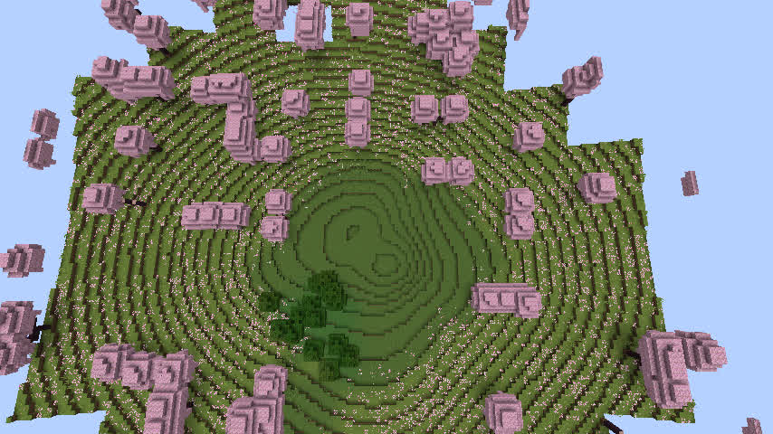
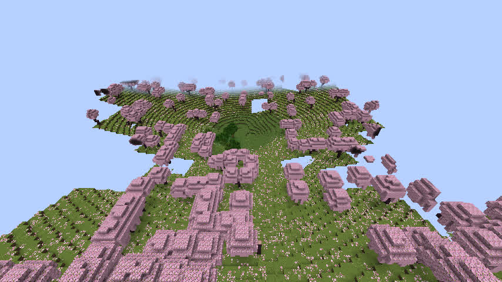

# GeoWorld R8.1r — 连续流向沟谷候选 v1.1.31 与发布门禁

日期：2026-11-13；机器：dadm；隔离工作树：`adm/geoworld-r81r-flow-aligned-sinkhole-20261113`；基线提交：`fa8ede6`。  
**最终结论：实现与构建 PASS，真实方块坡度 PASS，原生游戏视觉 FAIL；v0.1.5 正式发布不批准，候选不合并、不发布。**

## 1. 本轮唯一目标和改造

R8.1q 证明“多个偏心距离场”会叠加出多个漏斗，且使局部坡率变大。本轮**不继续叠加第二个洼地**：只在新规则 `geoworld-rules-v1.1.31` 中，保留 v1.1.29 的基础坡形，以 Feature ID 为稳定方向来源，定义一条沿局部坡向弯曲的冲沟（单一中心线 + 横向宽度 + 上游纵向区间），在同一路径的下游扩展为坡积扇。侵蚀与堆积高度被限制为归一化高度约 -0.0065 与 +0.0045，并在坑底、外围边界衰减为零。

这只是**沿连续流路的地貌启发式近似，不是水动力学、集水流量或严格物质守恒模拟**。没有修改真实河网、已保存世界模型字段、宏观地表或特殊地貌选址；所有 v1.1.30 / v1.1.29 / 更早的规则单独保留，只有新建候选世界采用 v1.1.31。

Go：`internal/specialfeatures/model.go` 的 `sinkholeFlowAlignedTransfer` 与版本门禁；Java：`java/runtime-reader/src/main/java/geoworld/runtime/GeoWorldV1.java` 的对等实现。新建世界 profile 规则 v1.1.31，引擎缓存版本 v31。

## 2. 代码与构建

- 新增专项 Go 测试 `r81r_flow_aligned_test.go`：冲沟到下游坡积区域连续、精确中心不动、外围不受影响、旧世界规则隔离、原有河流保护、不凭空生成低于计划坑底的第二个最低点。
- Go 模块 `internal/generator`、`internal/specialfeatures`、`internal/runtimeworld`、`internal/worldmodelio` 完整测试通过。
- 种子 `123456`、`20261112`，8 个天坑，Go/Java 高度、水域、地形类别配对 **3,072/3,072 PASS**；有明显高度差的模型采样点 **1,021**；跨语言最大归一化高度差约 `1.11e-16`。
- 河网、特殊地貌规划位置与宏观 Surface 严格保持不变；海岸回水版本同为 2；模型样点中没有改变已有水域或抬高天然地表。
- **Minecraft 1.21.1 NeoForge**：完整 `check build`，**BUILD SUCCESSFUL in 5m19s，44/44 actionable tasks**，矿业、河海岸、水文、结构与 WebUI 等检查通过。
- 该候选的 **26.3 NeoForge、1.20.1 Fabric、Windows 9 目标官方 CI 未执行**，不能称为正式全平台构建完成。

## 3. 原生 Minecraft 服务端、Anvil 方块

真正的 Minecraft 1.21.1 NeoForge 服务端新建世界 `R81rFreshSeed123456`，种子 `123456`，generator `geoworld:geoworld`，绑定 `geoworld-rules-v1.1.31`，天坑 #9 中心 X=6080 Z=7744。RCON 仅在本机开放；真实强制加载并保存 **225** 个区块，撤销强制加载、二次保存、正常停服。读取保存后的原生 Anvil 方块，而非仅计算预测模型：

| 实际方块指标 | 已有 v1.1.29 基线 | R8.1r v1.1.31 |
|---|---:|---:|
| 东西完整列 | 27/27 | 27/27 |
| 南北完整列 | 27/27 | 27/27 |
| 中心地面 Y | 74 | 74 |
| 中心积水 | 无 | 无 |
| 东西相邻 8 格最大坡率 | 0.500 | **0.500** |
| 南北相邻 8 格最大坡率 | 0.500 | **0.500** |
| 东西中心同高采样点 | 1 | 1 |
| 南北中心同高采样点 | 1 | 1 |

**方块层面没有重现 v1.1.30 的坡率退步，但没有再减少同高采样点。** 数据：`docs/acceptance/r81r_seed123456_actual_voxels.json`；工具：`scripts/r81r_actual_sinkhole_voxel_audit.py`。对应机读汇总 `docs/acceptance/r81r_real_client_visual_evidence.json` 保留了上版基线的数值，不依赖其他工作树存在。

## 4. 真实游戏画面：视觉 FAIL

使用真正的 Minecraft 1.21.1 NeoForge 客户端加载已保存世界的副本（Xvfb :104 + Mesa llvmpipe，正午，观察模式，HUD 隐藏）。相同相机位置：

- 俯视：`/tp @s 6080 160 7744 0 80`
- 斜视：`/tp @s 6080 155 7620 0 35`

俯视仍然清楚可见近乎规则的主环状台阶，右侧还有一处小型闭合等高低地。虽然不是 v1.1.30 的“两组独立距离场直接叠加”，但源/扇对底层径向碗的局部扰动**没有消除环纹，还生成次级闭合形态**。因此视觉真实度 FAIL；不能把“坡度没增加”当成“真实地貌已达标”。

图中远处部分蓝天缺口可能来自软件渲染时尚未加载网格；真实世界 54 个采样方块列完整，不能擅自称这些缺口是地形孔洞。

## 5. 何时能发布：阶段性决定

本轮明确停止在 R8.1r，**不再为了本次发布盲目开启 R8.1s 参数实验**。发布需要先决定范围：

1. **完整真实地貌目标的 v0.1.5**：当前仍有真实游戏视觉阻塞；应先脱离多圆心/径向碗的局部扰动路线，做单独、小范围、以真实集水/侵蚀/沉积组织的地形设计及游戏验收。没有可验证的完成日期；严禁宣称即将发布。
2. **缩小范围尽快发布**：将 v1.1.25–v1.1.31 尚未通过视觉验收的天坑改造整体排除在正式版之外，以最近**已经验收通过**的地貌/规则为基础，只整合其他已完成、验收合格的变更。为此需要独立 release 分支、版本绑定回归与版本间兼容证明；**不是直接拿本轮候选 JAR 打标签**。最后必须完成 26.3 NeoForge、1.20.1 Fabric、Windows 9 目标 CI 和干净存档回归后才能发布。
3. 现有仓库标签可见 `v0.1.5-rc.4`，但该标签的存在**不能替代本轮功能验收**，也不代表 v0.1.5 正式版已经发布。

**本次门禁**：代码构建 PASS、Go/Java 模型一致 PASS、原生方块坡度 PASS，**原生视觉 FAIL、全平台发布测试未完成**。因此 `visualPass=false`、`crossPlatformReleaseChecksPass=false`、`releaseEligible=false`、`officialRC=HOLD`。

本候选仅提交至隔离工作分支保存证据；不合并、不替换已有正常游戏版本、不发正式 JAR。
